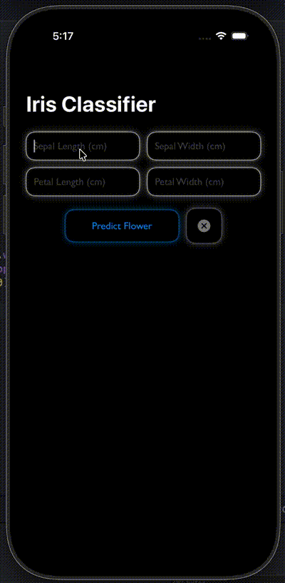

# IrisPredictionClient


A small SwiftUI iOS app that classifies Iris flowers in real time by sending petal and sepal measurements to a Flask ML backend over HTTP, then displaying the predicted species with contextual information.

---

## Why I built this

For fun, wanted to work with AI slop a little.

---

## System Architecture

```
iOS Client (Swift / SwiftUI / MVVM)
            |
            |  HTTP POST /predict
            |
Flask Server (Python / scikit-learn)
            |
            |  joblib
            |
RandomForestClassifier (.pkl)
```

---

## Demo

### Predicting all three species using sample values from the dataset


---

## Features

- Sends four flower measurements to a remote ML model via HTTP POST
- Displays predicted species with image and botanical description
- Spring animation on result appearance and dismissal
- Glassmorphism text fields with neon glow via custom `ViewModifier`
- Notebook-line background with gradient fade using SwiftUI `Canvas`
- Silvery gradient title with double white glow
- Clear button resets all inputs and dismisses the result instantly
- Per-field 3-character limit and input validation
- Error message with red neon glow, auto-dismissed on next prediction

---

## Project Structure

```
IrisPredictionClient-repo/
├── IrisPredictionClient/                        ← Xcode project
│   └── IrisPredictionClient/
│       ├── Views/
│       │   └── ContentView.swift
│       ├── ViewModels/
│       │   └── IrisViewModel.swift
│       ├── Models/
│       │   └── IrisModels.swift
│       ├── HexExtension.swift
│       ├── TextFieldStyle.swift
│       ├── IrisPredictionClientApp.swift
│       └── Assets.xcassets/
├── iris-api/
│   ├── app.py
│   └── train_model.py
├── assets/
│   └── demo.gif
└── README.md
```

---

## Sample Test Values

Use these to verify the model is working correctly:

| Sepal Length | Sepal Width | Petal Length | Petal Width | Expected Result |
|:------------:|:-----------:|:------------:|:-----------:|:---------------:|
| 5.1          | 3.5         | 1.4          | 0.2         | Setosa (0)      |
| 6.7          | 3.1         | 4.4          | 1.4         | Versicolor (1)  |
| 7.2          | 3.6         | 6.1          | 2.5         | Virginica (2)   |

---

## Running It Yourself

### Prerequisites

- Xcode 15+
- Python 3.8+
- pip

---

### 1. Train and start the Flask server

```bash
cd iris-api
pip install flask flask-cors joblib scikit-learn pandas numpy
python train_model.py
python app.py
```

Expected output:
```
* Running on http://127.0.0.1:5000
```

---

### 2. Run the iOS client

1. Open `IrisPredictionClient/IrisPredictionClient.xcodeproj` in Xcode
2. Set the server URL in `IrisViewModel.swift`:

```swift
// Simulator
static let baseURL = "http://127.0.0.1:5000"

// Physical device — find your IP in System Settings → Wi-Fi → Details
static let baseURL = "http://YOUR_LOCAL_IP:5000"
```

3. Run on Simulator or a physical device on the same Wi-Fi network

---

### 3. Verify with Postman (optional)

**POST** `http://127.0.0.1:5000/predict`

```json
{ "features": [5.1, 3.5, 1.4, 0.2] }
```

Expected response:

```json
{ "prediction": 0 }
```
